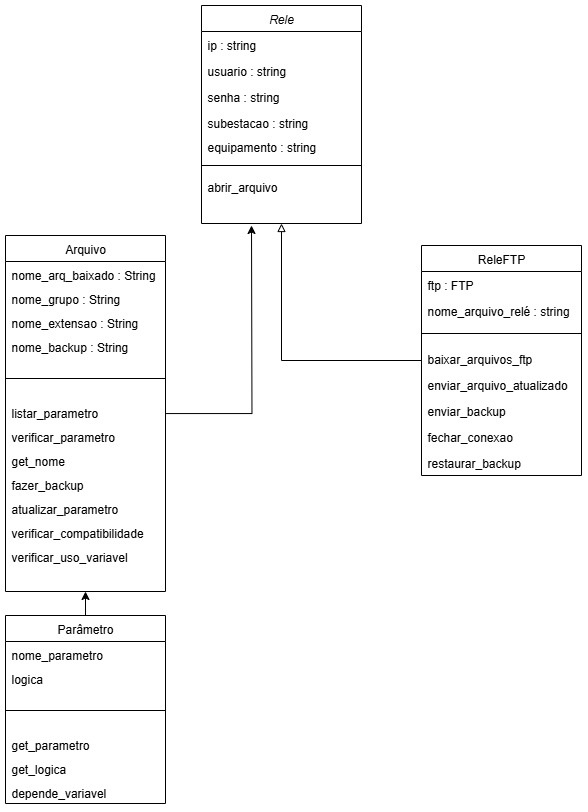

# SELFTools Library

Esta biblioteca em Python foi desenvolvida para facilitar a comunicação e automação de processos em relés SEL via protocolo FTP.  
Ela permite estabelecer conexões seguras com os equipamentos, realizar **backups de arquivos de configuração**, **atualizar e enviar parâmetros automaticamente**, além de disponibilizar ferramentas para **testar o mapa DNP3** e **listar o uso de lógicas internas**.  

O objetivo é simplificar tarefas de manutenção e gestão de relés, reduzindo o tempo de operação e aumentando a confiabilidade dos processos.


<p align="center">
  
</p>


---

## 🚀 Funcionalidades
- Conexão com relés SEL via FTP.
- Criação de arquivos backups.
- Atualização e envio automático de parâmetros com check de validação.
- Comentar OUTs e Restaurar OUTs originais.
- Teste do mapa DNP3.
- Listagem de uso de lógicas.

---

## 📘 Exemplos de Uso

### 1. Conexão e upload de parâmetros
```
# Conecta a algum equipamento informando nomes de SE,EQP,IP
SE = 'LAB'
EQP = 'ALTA_T1'
IP = '10.10.10.10'
rl = ReleFTP(IP,'2AC','TAIL',SE,EQP)

# Baixa o arquivo desejado
ARQ = 'SET_1.TXT'
rl.baixar_arquivos_ftp(ARQ)

# Abre o arquivo desejado
atualizado = 'LAB_ALTA_T1_SET_1__atualizado.TXT'
arq = rl.abrir_arquivo(atualizado)

# Faz backup 
backup = arq.fazer_backup()

# Escolhe o parâmetro que será atualizado e o novo valor que ele vai receber.
arq.atualizar_parametro('TR','RB20 # 51P1T OR 51G1T OR 51N1T OR 50P1T OR 50G1T OR 50N1T OR IN407 # IN407 = GAS T2')

# Envia para o relé após validação com o arquivo backup
rl.enviar_arquivo_atualizado(backup,atualizado)
```

### 2. Comentando OUTs
```
# Define os parâmetros de entrada
SE = 'LAB'
EQP = '751_105'
IP = '10.82.125.105'
rl = ReleFTP(IP,'2AC','TAIL',SE,EQP)

# Baixa o arquivo que for especificado (SET_L1 -> Lógicas do grupo 1)
rl.baixar_arquivos_ftp('SET_L1.TXT')

# Abre o arquivo baixado e faz o backup
arq = rl.abrir_arquivo('LAB_751_105_SET_L1__atualizado.TXT')
backup = arq.fazer_backup()

# Lista as OUTS atuais do equipamento
arq.lista_outs()

# Mostra como as OUTs ficam após o comentário
arq.comenta_outs()

# Envia o arquivo com as OUTs modificadas
rl.enviar_arquivo_atualizado(backup,'LAB_751_105_SET_L1__atualizado.TXT','SET_L1.TXT')

# Após a realização dos testes é possível restaurar as OUTS com o comando de enviar backup
# rl.enviar_backup(backup,'SET_L1.TXT')

```

## 📦 Instalação

Clone este repositório e instale as dependências:

```bash
git clone https://github.com/italojsr/Classes-FTP-/tree/master
cd sel-ftp-library
pip install -r requirements.txt
